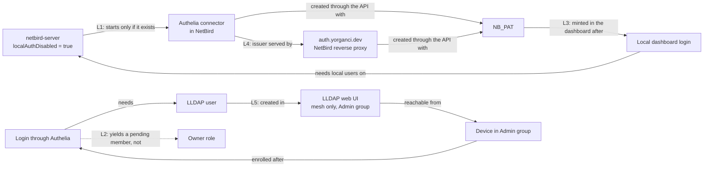
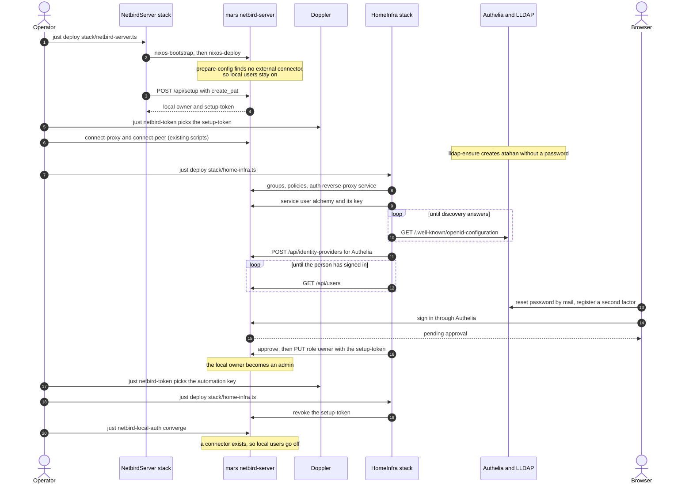
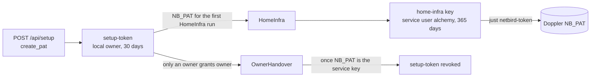
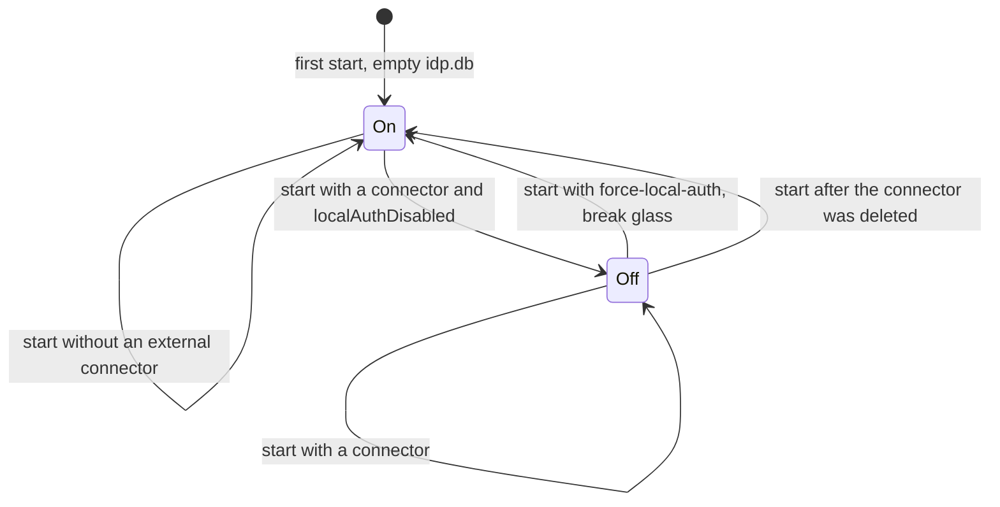
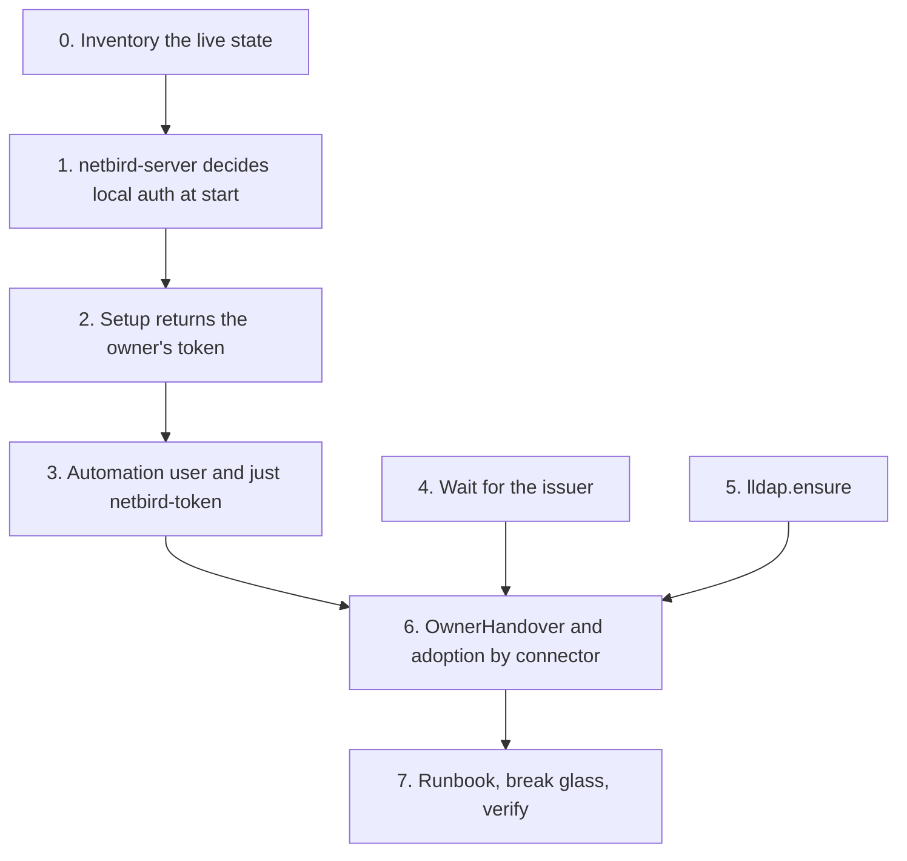

# Bootstrap plan: NetBird ↔ Authelia ↔ LLDAP

Branch `bootstrap` · Status: **proposal, nothing implemented yet** · NetBird 0.80.0 · LLDAP 0.6.3 · nixpkgs 26.05

## 1. Summary

mars runs NetBird with Authelia as its only login. Authelia checks users against LLDAP, and Authelia
itself is published through NetBird's reverse proxy. Each of these links is set up by something that
already needs the link before it. So a fresh install, or a mars rebuilt with an empty
`/var/lib/netbird`, can't come up without manual dashboard work. Some of the loops can't be broken by
hand at all unless you edit `mars.nix` first.

The fix gives every link one of two properties:

- **It tolerates a missing dependency and converges later.** Example: local login stays on until an
  external provider exists.
- **It gets its credential from the step before it, never from a person in a browser.** Example:
  `/api/setup` returns a token.

After that, one human step remains, and it can't be removed: the owner signs in through Authelia
once.

| #   | Loop                                                                                                   | Effect today                                                                                           | Fix                                                                                              | Phase |
| --- | ------------------------------------------------------------------------------------------------------ | ------------------------------------------------------------------------------------------------------ | ------------------------------------------------------------------------------------------------ | ----- |
| L1  | `localAuthDisabled` → a connector must exist → connectors are created through the API → the API needs a running server | `netbird-server` crash-loops on a fresh install, the mars deploy fails, and `Setup` never runs     | Decide local auth at every start: turn it off only once an external connector exists. Add a break-glass file | 1     |
| L2  | The owner is the local `/api/setup` user. Signing in through Authelia creates a different, pending user | Once local auth is off, the owner can't log in, and the person is a blocked member               | `NetBird.OwnerHandover` approves that user and transfers ownership, using the owner's own token    | 2, 6  |
| L3  | `NB_PAT` is minted in the dashboard → that needs a local login                                         | A manual step, and impossible once local auth is off                                                   | `/api/setup` returns the owner's first PAT. The stack creates a service user and key. `just netbird-token` copies it | 2, 3  |
| L4  | Creating the provider checks the issuer → the issuer is the `auth` reverse-proxy service → which is created in the same stack | The first HomeInfra run fails or succeeds depending on scheduling                                      | An explicit ordering edge, plus waiting for the discovery document                               | 4     |
| L5  | Logging in needs an LLDAP user → the LLDAP UI is reachable only from the mesh, for Admin → that needs a login | The first user can only be created over an SSH tunnel                                                  | A declarative `lldap.ensure` oneshot on mars. The password is set through Authelia's reset mail   | 5     |
| L6  | The owner is adopted by email                                                                          | After the handover two users share `me.email`, and `findUserByEmail` picks either one                   | Adopt by email **and** connector (`idp_id`)                                                       | 6     |

## 2. Today: why a fresh install deadlocks



What NetBird 0.80.0 actually does (paths are relative to the `netbirdio/netbird` source):

| Behaviour                                                                                                                | Where                                                                    |
| ------------------------------------------------------------------------------------------------------------------------ | ------------------------------------------------------------------------ |
| With `LocalAuthDisabled` and no other connector, startup fails: _"cannot disable local authentication: no other identity providers configured"_ | `management/server/idp/embedded.go:400-412`                              |
| `CreateUserWithPassword`, which `/api/setup` uses, fails while local auth is off: _"local user creation is disabled"_     | `management/server/idp/embedded.go:593-596`                              |
| A new account sets `UserApprovalRequired: true`, so a connector user joins as `Blocked` + `PendingApproval`               | `management/server/account.go:1379`, `:2088`                              |
| Only an owner may give someone the owner role. Service users can't be owners. The old owner becomes admin                 | `management/server/user.go:906-916`, `:968-972`                           |
| `NB_SETUP_PAT_ENABLED=true` plus `create_pat` returns a PAT named `setup-token` that lives 1–365 days (default 1)          | `management/server/instance/setup_service.go`                             |
| A user's `idp_id` is the connector decoded from its Dex user ID; for local users it's `local`                             | `management/server/user.go` (`getUserInfo`)                               |
| Connectors are stored in `${dataDir}/idp.db`, table `connector`, whose local row is `id = 'local'`                        | `combined/cmd/config.go:602`, `netbirdio/dex` `storage/sql/migrate.go`    |
| Re-enabling local auth recreates the local connector, and local users can log in again                                    | `idp/dex/provider.go:231-235`                                             |

## 3. Target: how a fresh install converges

### 3.1 From zero



### 3.2 Token lifecycle



- **The setup token's only jobs:** run HomeInfra once, and grant the owner role, which only an
  owner may do. It's revoked as soon as nothing depends on it.
- **The service user's key:** day to day, everything uses it (the stacks and `doppler run`
  scripts). It isn't tied to a person, and nothing ever takes away its rights.

### 3.3 Local login, decided at every start



## 4. Phases



Phases 1, 4 and 5 don't depend on each other. Phase 6 needs all of them. Each phase is one or two
commits on `bootstrap` (§9). Each one is safe to deploy to the running installation on its own (§5).

---

### Phase 0: inventory the live state (no code)

**Goal:** find out which migration path the running installation needs (§5) before anything changes.

```sh
cd packages/stack

# Who owns the account, through which connector, and which users are service users.
just verify

# Whose token NB_PAT is.
doppler run -- sh -c 'curl -fsS -H "Authorization: Token $NB_PAT" "$NB_MANAGEMENT_URL/api/users/current"' |
  jq '{id, email, role, is_service_user, idp_id}'

# Which connectors the embedded IdP has (expect local and the Authelia one).
ssh mars sudo sqlite3 -readonly /var/lib/netbird/idp.db "select id, type, name from connector"
```

**Record these:**
- **Case A or B.** Case A: the owner's `idp_id` is the Authelia connector. Case B: the owner is
  still `local`.
- **The service user behind `NB_PAT`, if there is one.** Phase 3 adopts it by name.

---

### Phase 1: `netbird-server` never refuses to start

**Fixes:** L1, and adds break glass. **Files:** `modules/nixos/netbird-server.nix`, `modules/hosts/mars.nix`.

- **Templating:** `localAuthDisabled` becomes a placeholder in the config template, filled in by
  `prepareConfig` at every start.
- **The rule:** disabled only when the option is on, there's no break-glass file, and `idp.db`
  holds at least one connector other than `local`. That's the same precondition NetBird enforces,
  except it degrades instead of crashing.
- **Setup tokens:** the server runs with `NB_SETUP_PAT_ENABLED=true`, so Phase 2 can get one.
  NetBird only honours it while setup is still required.

```nix
# modules/nixos/netbird-server.nix (excerpts)
configTemplate = pkgs.writeText "netbird-server-config.yaml" ''
  …
    auth:
      issuer: "https://${cfg.domain}/oauth2"
      localAuthDisabled: @localAuthDisabled@
  …
'';

prepareConfig = pkgs.writeShellApplication {
  name = "netbird-server-prepare-config";
  runtimeInputs = [pkgs.openssl pkgs.replace-secret pkgs.sqlite];
  text = ''
    …
    replace-secret '@sessionCookieKey@' "$session_cookie_key" "$runtime_config"

    # NetBird refuses to start with local users off and no external
    # provider, and providers only come from its API: turn them off only
    # once one exists, so a new installation can run setup first.
    local_auth_disabled=false
    if [[ ${lib.boolToString cfg.localAuthDisabled} == true ]]; then
      idp_db=${lib.escapeShellArg "${stateDir}/idp.db"}
      force=${lib.escapeShellArg "${stateDir}/force-local-auth"}
      external=0
      if [[ -s $idp_db ]]; then
        external="$(sqlite3 -readonly "$idp_db" \
          "SELECT count(*) FROM connector WHERE id <> 'local';" 2>/dev/null || echo 0)"
      fi
      if [[ -e $force ]]; then
        echo "local users stay on: $force exists" >&2
      elif ((external == 0)); then
        echo "local users stay on until an external identity provider exists" >&2
      else
        local_auth_disabled=true
      fi
    fi
    sed -i "s/@localAuthDisabled@/$local_auth_disabled/" "$runtime_config"
    echo "$local_auth_disabled" >${lib.escapeShellArg "${runtimeDir}/local-auth-disabled"}
  '';
};

# …
systemd.services.netbird-server = {
  # POST /api/setup may also return the new owner's token (NetBird.Setup's
  # `createPat`); NetBird honours it only while setup is still required.
  environment.NB_SETUP_PAT_ENABLED = "true";
  …
};
```

```nix
# option description
localAuthDisabled = lib.mkOption {
  type = lib.types.bool;
  default = false;
  description = ''
    Turn off the embedded IdP's local users (email and password) once an
    external provider exists. NetBird refuses to start with them off and no
    provider, and providers only come from the API, so the server decides at
    every start: without a provider in its IdP store (a new installation, or
    one whose provider was deleted) it keeps local users on and says so in the
    journal; with one, it turns them off. `${stateDir}/force-local-auth` keeps
    them on regardless (`just netbird-local-auth on`). The effective value is in
    `${runtimeDir}/local-auth-disabled`. Service-user tokens work either way.
  '';
};
```

```nix
# modules/hosts/mars.nix
netbird-server = {
  …
  # Authelia is NetBird's only login once its provider exists; until then (a
  # new installation) local users stay on so setup can run. Recovery:
  # `just netbird-local-auth on`, then the setup password in NetbirdServer's
  # state. The stack's service-user token works throughout.
  authelia.enable = true;
  localAuthDisabled = true;
};
```

```just
# packages/stack/Justfile: break glass and convergence, over the public address
# (the mesh may be what is broken).
[doc("Turn NetBird's local users on (break glass) or back off, or restart to converge")]
netbird-local-auth state:
    #!/usr/bin/env bash
    set -euo pipefail
    host="$(nix eval --raw '{{ repo_root }}#infra.netbirdManagementDomain')"
    case "{{ state }}" in
        on) cmd='sudo touch /var/lib/netbird/force-local-auth' ;;
        off) cmd='sudo rm -f /var/lib/netbird/force-local-auth' ;;
        converge) cmd=true ;;
        *) echo "state must be on, off or converge" >&2; exit 2 ;;
    esac
    ssh -o HostKeyAlias=mars "atahan@$host" \
        "$cmd && sudo systemctl restart netbird-server && cat /run/netbird-server/local-auth-disabled"
```

**Tests**
- **Eval checks:** `nix eval .#nixosConfigurations.mars.config.systemd.services.netbird-server.environment`.
  The existing assertion still holds (`localAuthDisabled` needs a declared provider).
- **VM test (optional, needs a Linux builder):** `checks.x86_64-linux.netbird-server-local-auth`
  covers four starts:
  1. Empty state, `localAuthDisabled = true`: the unit is active, `/api/instance` reports
     `setup_required`, and `/api/setup` succeeds.
  2. A provider is added (pointing at a static discovery document served inside the VM) and the
     server restarts: the state file says `true`.
  3. `force-local-auth` is touched and the server restarts: the file says `false`.

**Done when**
- mars deploys from an empty `/var/lib/netbird` with `localAuthDisabled = true`.
- On the live mars, the journal shows no "local users stay on" line and the state file says `true`.

**Live impact:** one `netbird-server` restart, because the unit changes. Local auth stays off, since
the connector exists.

---

### Phase 2: `NetBird.Setup` returns the owner's first token

**Fixes:** L3 (first half). **Files:** `packages/netbird-alchemy/src/Setup/Setup.ts`,
`packages/stack/stack/netbird-server.ts`, `packages/stack/src/netbird-server-stack.ts`,
`packages/netbird-alchemy/README.md`.

```ts
// packages/netbird-alchemy/src/Setup/Setup.ts (excerpts)
export interface SetupProps {
	// …
	/**
	 * Also ask `/api/setup` for a personal access token of the new owner. The
	 * server has to run with `NB_SETUP_PAT_ENABLED=true`, or NetBird ignores it
	 * and `token` stays empty. Only the first setup can return one.
	 *
	 * @default false
	 */
	createPat?: boolean;
	/** Lifetime of that token in days (1–365). @default 30 */
	patExpireIn?: number;
}

export interface SetupAttributes {
	// …
	/** The owner's token from the first setup (`setup-token`); never returned again. */
	token?: Redacted.Redacted<string>;
}

const SetupResponse = Schema.Struct({
	user_id: Schema.String,
	email: Schema.String,
	personal_access_token: Schema.optional(Schema.String),
});

// reconcile, setup already complete: keep what the first setup returned
if (!instance.setup_required) {
	if (output?.password) {
		return { ...output, apiBaseUrl } satisfies SetupAttributes; // includes `token`
	}
	// …
}

// reconcile, first setup
HttpClientRequest.bodyJson({
	email,
	name,
	password: Redacted.value(password),
	...(props.createPat ? { create_pat: true, pat_expire_in: props.patExpireIn ?? 30 } : {}),
});
// …
if (props.createPat && created.personal_access_token === undefined) {
	yield* Effect.logWarning("NetBird returned no setup token; is NB_SETUP_PAT_ENABLED set on the server?");
}
return {
	userId: created.user_id,
	email: created.email,
	password,
	apiBaseUrl,
	...(created.personal_access_token ? { token: Redacted.make(created.personal_access_token) } : {}),
} satisfies SetupAttributes;
```

`diffSetup` doesn't change. It only compares `apiBaseUrl`, so adding `createPat` to the live stack
is a no-op.

```ts
// packages/stack/stack/netbird-server.ts
const setup = yield* NetBird.Setup("Admin", {
	apiBaseUrl: netbirdApiBaseUrl,
	email: me.email,
	name: me.name,
	// The owner's first token: NB_PAT for HomeInfra's first run, and what hands
	// ownership to the Authelia account (only an owner can). HomeInfra revokes it.
	createPat: true,
	patExpireIn: 30,
	ready: Output.map(Output.all(netbirdRecord.content, marsNixos.system), () => true),
});
// …
admin: { email: setup.email, password: setup.password, token: setup.token },
```

```ts
// packages/stack/src/netbird-server-stack.ts
admin: {
	email: string;
	password: Redacted.Redacted<string>;
	/** The owner's setup token; absent on installations set up before it existed. */
	token?: Redacted.Redacted<string>;
};
```

**Tests**
- **Unit:** `Setup.test.ts` gains cases asserting that `createPat` and `patExpireIn` never change
  the diff.
- **Integration:**
  - `createHarness(name, { bootstrap: false })` boots the Docker fixture without calling
    `/api/setup` itself. The fixture already sets `NB_SETUP_PAT_ENABLED`.
  - Deploying `Setup` with `createPat` returns a token that `GET /api/users/current` accepts.
  - A second deploy keeps the same token.

**Done when:** a fresh fixture yields a working token from `Setup` alone. The README no longer tells
you to "mint a token in the dashboard".

---

### Phase 3: an automation identity, and `just netbird-token`

**Fixes:** L3 (second half). **Files:** `packages/stack/stack/home-infra.ts`,
`packages/stack/src/home-infra-stack.ts`, `packages/stack/scripts/netbird-token.ts` (new),
`packages/stack/Justfile`.

HomeInfra creates its own service user with the standard `User` and `ApiKey` resources, using
whatever `NB_PAT` it starts with. On a fresh install that's the setup token.

```ts
// packages/stack/stack/home-infra.ts
// The stacks' own NetBird identity: a service user, so nothing depends on a
// person's account. Its key becomes NB_PAT once `just netbird-token` copies it.
// Retained: destroying the stack must not lock the next run out.
const automation = yield* NetBird.User("Automation", {
	name: "alchemy", // or the service user Phase 0 found behind NB_PAT
	role: "admin",
	isServiceUser: true,
}).pipe(Alchemy.RemovalPolicy.retain());
const automationKey = yield* NetBird.ApiKey("AutomationKey", {
	userId: automation.userId,
	// Renaming replaces the key: that is how it is rotated.
	name: "home-infra",
	expiresIn: 365,
}).pipe(Alchemy.RemovalPolicy.retain());

return {
	// …
	automation: {
		userId: automation.userId,
		tokenId: automationKey.tokenId,
		token: automationKey.token,
		expirationDate: automationKey.expirationDate,
	},
};
```

`scripts/netbird-token.ts` is built on the same scaffolding as `store-secret.ts`, which already
reads both stacks' outputs.

```ts
/**
 * Points Doppler's NB_PAT at the best NetBird token the stacks hold:
 *
 *   1. HomeInfra's `automation.token` (the service user's key), once it exists;
 *   2. NetbirdServer's `admin.token` (the owner's setup token), before that.
 *
 * Each candidate is tried against GET /api/users/current first, so an expired
 * or revoked one is skipped. The value reaches Doppler on stdin, never as an
 * argument. `--dry-run` only reports which one it would pick.
 */
const candidates = [
	{ source: "HomeInfra automation.token", path: ["automation", "token"], stack: "HomeInfra" },
	{ source: "NetbirdServer admin.token", path: ["admin", "token"], stack: "NetbirdServer" },
] as const;

for (const candidate of candidates) {
	const token = yield* readOutput(candidate.stack, candidate.path); // Option<Redacted<string>>
	if (Option.isNone(token)) continue;
	const user = yield* usersCurrentGet({}).pipe(
		Effect.provide(credentials({ apiToken: Redacted.value(token.value), managementUrl })),
		Effect.option,
	);
	if (Option.isNone(user)) {
		yield* Console.log(`${candidate.source}: rejected by NetBird, skipped`);
		continue;
	}
	yield* Console.log(`${candidate.source}: ${user.value.name} (${user.value.role})`);
	if (!dryRun) yield* setDopplerSecret("NB_PAT", token.value); // `doppler secrets set NB_PAT --silent` < stdin
	return;
}
return yield* Effect.fail(new NoUsableToken({ message: "no working NetBird token in either stack; see docs/bootstrap.md" }));
```

```just
# Point Doppler's NB_PAT at the stacks' working NetBird token: HomeInfra's
# automation key, else NetbirdServer's setup token.
[doc("Point Doppler's NB_PAT at the stacks' working NetBird token")]
netbird-token *args:
    {{ node }} scripts/netbird-token.ts {{ args }}
```

**Tests**
- `User.test.ts` and `ApiKey.test.ts` already cover these resources.
- `just netbird-token --dry-run` against the live stage names the source it would pick.

**Done when:** HomeInfra outputs `automation.token`, and after `just netbird-token`, `just verify`
runs as `alchemy`.

**Live impact:** adds one service user and one key (or adopts the Phase 0 user). `NB_PAT` changes
only when you run the recipe.

---

### Phase 4: create the Authelia provider only once its issuer answers

**Fixes:** L4. **Files:** `packages/netbird-alchemy/src/IdentityProvider/IdentityProvider.ts`,
`packages/stack/stack/home-infra.ts`.

There are two parts:
1. **An ordering edge.** It makes the provider wait for the reverse-proxy service that serves its
   issuer.
2. **A bounded wait inside the provider.** It polls the discovery document before POST or PUT,
   because the proxy may still be getting its certificate.

```ts
// IdentityProvider.ts (excerpts)
export interface IdentityProviderProps {
	// …
	/**
	 * How long to wait for `<issuer>/.well-known/openid-configuration` to answer,
	 * naming this issuer, before creating or updating the provider: NetBird
	 * refuses an issuer it cannot fetch, and a new one (behind NetBird's own
	 * reverse proxy, say) may still be getting its certificate.
	 *
	 * @default "5 minutes"
	 */
	issuerTimeout?: Duration.Input;
	/** Ordering only (e.g. the reverse-proxy service serving the issuer); ignored by the provider. */
	ready?: string | boolean | null;
}

const Discovery = Schema.Struct({ issuer: Schema.String });

const awaitIssuer = (issuer: string, timeout: Duration.Input) =>
	Effect.gen(function* () {
		const client = yield* HttpClient.HttpClient;
		const url = `${issuer.replace(/\/+$/, "")}/.well-known/openid-configuration`;
		yield* client.get(url).pipe(
			Effect.flatMap(HttpClientResponse.filterStatusOk),
			Effect.flatMap(HttpClientResponse.schemaBodyJson(Discovery)),
			Effect.filterOrFail(
				doc => doc.issuer === issuer,
				doc => new IssuerNotReady({ issuer, reason: `discovery names ${doc.issuer}` }),
			),
			Effect.tapError(cause => Effect.logInfo(`waiting for ${url}: ${String(cause)}`)),
			Effect.retry({
				schedule: Schedule.spaced("5 seconds"),
				times: Math.ceil(Duration.toSeconds(Duration.decode(timeout)) / 5),
			}),
		);
	});

// reconcile: before identityProvidersPost / identityProvidersIdpIdPut
if (news.issuer) yield* awaitIssuer(news.issuer, news.issuerTimeout ?? "5 minutes");
```

The `diff` ignores `ready` and `issuerTimeout`, the same way `diffSetup` ignores `ready`.

```ts
// home-infra.ts: keep the services by domain, not only their names
const proxyServices: Record<string, NetBird.ReverseProxyService> = {};
for (const plan of plans) {
	// …
	proxyServices[plan.domain] = yield* NetBird.ReverseProxyService(String.pascalCase(plan.serviceKey), /* … */);
	services[plan.serviceKey] = plan.domain;
}

// …
const identityProviderResources: Record<string, NetBird.IdentityProvider> = {};
for (const plan of yield* IdentityProviders.plans(identityProviderConfigs)) {
	// An issuer published through our own reverse proxy has to exist before
	// NetBird checks it; the provider then waits for its discovery document.
	const servedBy = proxyServices[new URL(plan.cfg.issuer).host];
	const idp = yield* NetBird.IdentityProvider(`${String.pascalCase(plan.providerKey)}IdentityProvider`, {
		name: plan.cfg.name,
		type: plan.cfg.type,
		issuer: plan.cfg.issuer,
		clientId: plan.cfg.clientId,
		clientSecret: yield* Sops.decrypt(plan.secretsFile, plan.cfg.clientSecret),
		...(servedBy ? { ready: servedBy.serviceId } : {}),
	});
	identityProviderResources[plan.providerKey] = idp;
	identityProviders[plan.providerKey] = { idpId: idp.idpId, redirectUrl: idp.redirectUrl };
}
```

**Tests**
- **Unit:** `awaitIssuer` with a stub `HttpClient` layer covers three cases: 503 then 200 succeeds,
  a mismatched issuer fails, and a timeout fails.
- **Integration:** the existing `IdentityProvider.test.ts`, which uses Google's issuer, still passes.

**Done when:** the plan shows `AutheliaIdentityProvider` after the `Auth` service, and a deploy
logs the waits.

**Live impact:** `ready` appears as a new prop, so the plan shows one update. Reconcile finds no
drift and writes nothing.

---

### Phase 5: LLDAP declares the first user

**Fixes:** L5. **Files:** `modules/nixos/lldap.nix`, `modules/hosts/mars.nix`, and optionally
`modules/nixos/authelia.nix`.

The design:
- **Additive and idempotent:** a oneshot creates missing groups, missing users, and missing
  memberships. It never deletes anything and never sets passwords.
- **Passwords:** the person sets theirs through Authelia's _Reset password_, which mails a link
  through SES. The SES sandbox already allows `me.email`.
- **Implementation:** it talks to LLDAP's GraphQL API with `curl` and `jq` directly, because
  `lldap-cli` builds JSON by string interpolation and prints tables.

```nix
# modules/nixos/lldap.nix (excerpts)
options.lldap.ensure = {
  groups = lib.mkOption {
    type = lib.types.listOf lib.types.str;
    default = [];
    example = ["admin"];
    description = "Groups created if missing. Never deleted.";
  };
  users = lib.mkOption {
    type = lib.types.attrsOf (lib.types.submodule {
      options = {
        email = lib.mkOption {type = lib.types.str;};
        displayName = lib.mkOption {
          type = lib.types.str;
          default = "";
        };
        groups = lib.mkOption {
          type = lib.types.listOf lib.types.str;
          default = [];
          description = "Groups the user is added to if missing; never removed from.";
        };
      };
    });
    default = {};
    description = ''
      Users created if missing, by user ID, without a password: the person
      sets one through Authelia's "Reset password", which mails a link.
      Nothing here deletes a user or takes a group away.
    '';
  };
};

config = lib.mkIf cfg.enable {
  # …
  systemd.services.lldap-ensure = lib.mkIf (cfg.ensure.groups != [] || cfg.ensure.users != {}) (let
    spec = pkgs.writeText "lldap-ensure.json" (builtins.toJSON cfg.ensure);
  in {
    description = "Create LLDAP's declared users and groups";
    requires = ["lldap.service"];
    after = ["lldap.service"];
    wantedBy = ["multi-user.target"];
    restartTriggers = [spec];
    path = [pkgs.curl pkgs.jq];
    serviceConfig = {
      Type = "oneshot";
      RemainAfterExit = true;
      DynamicUser = true;
      RuntimeDirectory = "lldap-ensure";
      LoadCredential = ["admin-password:${secret "lldap/admin-password"}"];
    };
    script = ''
      set -euo pipefail
      base=http://127.0.0.1:${toString cfg.httpPort}
      spec=${spec}
      headers="$RUNTIME_DIRECTORY/headers"

      # The token goes into a header file, never onto a command line.
      jq -n --rawfile p "$CREDENTIALS_DIRECTORY/admin-password" \
          '{username: "admin", password: ($p | rtrimstr("\n"))}' |
        curl -fsS --retry 30 --retry-connrefused --retry-delay 1 \
          -H 'Content-Type: application/json' --data-binary @- "$base/auth/simple/login" |
        jq -r '"Authorization: Bearer " + .token' >"$headers"

      gql() { # query, variables
        jq -n --arg q "$1" --argjson v "$2" '{query: $q, variables: $v}' |
          curl -fsS -H @"$headers" -H 'Content-Type: application/json' \
            --data-binary @- "$base/api/graphql" |
          jq -e 'if .errors then error(.errors[0].message) else .data end'
      }
      group_id() {
        gql '{groups{id displayName}}' '{}' |
          jq -r --arg n "$1" '.groups[] | select(.displayName == $n) | .id'
      }

      jq -r '.groups[]' "$spec" | while IFS= read -r g; do
        [[ -n $(group_id "$g") ]] ||
          gql 'mutation($n:String!){createGroup(name:$n){id}}' "$(jq -n --arg n "$g" '{n: $n}')" >/dev/null
      done

      jq -c '.users | to_entries[]' "$spec" | while IFS= read -r entry; do
        id="$(jq -r .key <<<"$entry")"
        vars="$(jq -n --arg id "$id" '{id: $id}')"
        if ! gql 'query($id:String!){user(userId:$id){id}}' "$vars" >/dev/null 2>&1; then
          gql 'mutation($u:CreateUserInput!){createUser(user:$u){id}}' \
            "$(jq '{u: {id: .key, email: .value.email, displayName: .value.displayName}}' <<<"$entry")" >/dev/null
        fi
        have="$(gql 'query($id:String!){user(userId:$id){groups{displayName}}}' "$vars" | jq -r '.user.groups[].displayName')"
        jq -r '.value.groups[]' <<<"$entry" | while IFS= read -r g; do
          grep -qxF "$g" <<<"$have" && continue
          gql 'mutation($u:String!,$g:Int!){addUserToGroup(userId:$u,groupId:$g){ok}}' \
            "$(jq -n --arg u "$id" --argjson g "$(group_id "$g")" '{u: $u, g: $g}')" >/dev/null
        done
      done
    '';
  });
};
```

```nix
# modules/hosts/mars.nix
lldap = {
  enable = true;
  # The owner's account, which NetBird's ownership is handed to. No password is
  # kept anywhere: it is set through Authelia's "Reset password" (mailed via SES).
  ensure = {
    groups = ["admin"];
    users.${user.username} = {
      inherit (user) email;
      displayName = user.name;
      groups = ["admin" "lldap_admin"];
    };
  };
};
```

**Optional:** in `authelia.nix`, also ensure every group any client restricts itself to. Today
that's `admin`, for Hermes:
`lldap.ensure.groups = lib.unique (lib.concatMap (c: c.groups) (lib.attrValues declared));`.

**Tests**
- **Eval:** `nix eval --json .#nixosConfigurations.mars.config.lldap.ensure`.
- **VM test (optional):** LLDAP on SQLite plus `lldap-ensure`. Starting it twice changes nothing.
  The user and its groups show up through GraphQL.

**Done when:** on a fresh LLDAP, `atahan` exists and is in `admin` and `lldap_admin`, and the
Authelia reset mail arrives.

**Live impact:** none if the user and groups already exist. Missing memberships are added.

---

### Phase 6: hand ownership to the Authelia account, and adopt by connector

**Fixes:** L2 and L6. **Files:**
- New: `packages/netbird-alchemy/src/OwnerHandover/{OwnerHandover,index}.ts`
- `Providers.ts`, `index.ts`, `errors.ts`
- `User/User.ts`
- `modules/shared/identity-provider.nix`, `modules/flake/identity-providers.nix`,
  `modules/nixos/netbird-server.nix`
- `packages/stack/src/identity-providers.ts`, `packages/stack/stack/home-infra.ts`

#### 6a. Which provider the owner signs in with is declared in Nix

```nix
# modules/shared/identity-provider.nix, per provider
ownerLogin = lib.mkOption {
  type = lib.types.bool;
  default = false;
  description = ''
    The provider the account owner (`flake.me.email`) signs in with: HomeInfra
    hands NetBird's ownership from the local setup user to that person's
    account through it. At most one per flake.
  '';
};

# modules/nixos/netbird-server.nix, autheliaIntegration
identityProviders.authelia = {
  inherit (cfg.authelia) name;
  issuer = config.oidcIssuer;
  clientId = "netbird";
  clientSecret = autheliaSecret;
  ownerLogin = true;
};

# modules/flake/identity-providers.nix: add a check next to the uniqueness ones
else if lib.length (lib.filter (p: p.ownerLogin) allProviders) > 1
then throw "flake.identityProviders: more than one provider has ownerLogin"
```

`packages/stack/src/identity-providers.ts` adds `ownerLogin: Schema.Boolean` to
`IdentityProviderConfig`.

#### 6b. `NetBird.OwnerHandover`

```ts
// packages/netbird-alchemy/src/OwnerHandover/OwnerHandover.ts (sketch)
export interface OwnerHandoverProps {
	/** Email of the person who becomes the owner. */
	email: string;
	/** Connector they sign in through: `NetBird.IdentityProvider`'s `idpId`. */
	idpId: string;
	/**
	 * A personal access token of the current owner (`NetBird.Setup`'s `token`):
	 * only an owner may make someone else owner. Unused once the handover is
	 * done, and revoked then if the provider no longer authenticates with it.
	 */
	ownerToken?: Redacted.Redacted<string>;
	/** How long a deploy waits for the person's first sign-in. @default "15 minutes" */
	loginTimeout?: Duration.Input;
}

export interface OwnerHandoverAttributes {
	/** The owner: the person's account on the connector. */
	userId: string;
	email: string;
	idpId: string;
	/** The owner before the handover, now an admin; absent when there was none to do. */
	previousOwnerId: string | undefined;
	/** Whether the setup token is gone (revoked here, expired, or never existed). */
	setupTokenRevoked: boolean;
}

type ApiUser = Pick<User, "id" | "email" | "role" | "idp_id" | "pending_approval" | "is_service_user" | "auto_groups">;

/** The next step, from the account's users. Pure, for unit tests. */
export const planHandover = (users: ReadonlyArray<ApiUser>, { email, idpId }: { email: string; idpId: string }) => {
	const person = users.find(u => !u.is_service_user && u.email === email && u.idp_id === idpId);
	if (person === undefined) return { _tag: "AwaitLogin" } as const;
	if (person.role === "owner") return { _tag: "Done", person } as const;
	return {
		_tag: "Transfer",
		person,
		owner: users.find(u => u.role === "owner"),
		approve: person.pending_approval,
	} as const;
};

export const OwnerHandoverProvider = () =>
	Provider.succeed(OwnerHandover, {
		stables: ["userId", "email", "idpId"],
		// `ownerToken` and `loginTimeout` never change what the handover is.
		diff: ({ news, olds }) =>
			Effect.sync(() =>
				isResolved(news) && olds && news.email === olds.email && news.idpId === olds.idpId
					? ({ action: "noop" } as const)
					: undefined,
			),
		reconcile: Effect.fn(function* ({ news, output }) {
			const { managementUrl } = yield* yield* Credentials;
			const asOwner = <A, E, R>(effect: Effect.Effect<A, E, R>) =>
				news.ownerToken === undefined
					? Effect.fail(
							new NetBirdOwnerHandoverError({
								message:
									"the owner role can only be granted with the current owner's token: " +
									"pass NetBird.Setup's `token` (or NB_OWNER_PAT); see docs/bootstrap.md",
							}),
						)
					: effect.pipe(
							Effect.provideService(Credentials, Effect.succeed({ apiToken: news.ownerToken, managementUrl })),
						);

			// 1. The person's account exists only after their first sign-in.
			const step = yield* usersGet({}).pipe(
				Effect.map(users => planHandover(users, news)),
				Effect.filterOrFail(
					step => step._tag !== "AwaitLogin",
					() =>
						new NetBirdOwnerHandoverError({
							message: `waiting for ${news.email} to sign in to ${managementUrl} through connector ${news.idpId}`,
						}),
				),
				Effect.tapError(error => Effect.logInfo(error.message)),
				Effect.retry({ schedule: Schedule.spaced("10 seconds"), times: attempts(news.loginTimeout ?? "15 minutes", 10) }),
			);

			let previousOwnerId = output?.previousOwnerId;
			if (step._tag === "Transfer") {
				// 2. A pending user is blocked until approved; an admin suffices.
				if (step.approve) yield* usersUserIdApprovePost({ userId: step.person.id });
				// 3. Only the owner grants owner; NetBird makes the old owner an admin.
				yield* asOwner(
					usersUserIdPut({
						userId: step.person.id,
						role: "owner",
						auto_groups: [...step.person.auto_groups],
						is_blocked: false,
					}),
				);
				previousOwnerId = step.owner?.id;
			}

			// 4. Revoke the setup token, unless this deploy still runs on it.
			const setupTokenRevoked =
				output?.setupTokenRevoked === true || (yield* revokeSetupToken(news.ownerToken, managementUrl));

			return { userId: step.person.id, email: news.email, idpId: news.idpId, previousOwnerId, setupTokenRevoked };
		}),
		read: ({ output }) => Effect.succeed(output),
		list: () => Effect.succeed([]),
		// Removing the resource never demotes anyone.
		delete: () => Effect.void,
	});

/** Deletes `setup-token` once NB_PAT is something else; true when it is gone. */
const revokeSetupToken = (token: Redacted.Redacted<string> | undefined, managementUrl: string) =>
	Effect.gen(function* () {
		if (token === undefined) return true;
		const withToken = Effect.provideService(Credentials, Effect.succeed({ apiToken: token, managementUrl }));
		const holder = yield* usersCurrentGet({}).pipe(withToken, catchUnauthorized); // undefined: expired or revoked
		if (holder === undefined) return true;
		const self = yield* usersCurrentGet({});
		if (self.id === holder.id) {
			yield* Effect.logWarning("NB_PAT is still the setup token: run `just netbird-token`, then deploy again to revoke it");
			return false;
		}
		const tokens = yield* usersUserIdTokensGet({ userId: holder.id }).pipe(withToken);
		for (const t of tokens.filter(t => t.name === "setup-token")) {
			yield* usersUserIdTokensTokenIdDelete({ userId: holder.id, tokenId: t.id }).pipe(withToken);
		}
		return true;
	});
```

`errors.ts` gains `isUnauthorized` and `catchUnauthorized`, written like `isNotFound` and
`catchNotFound`. The resource is registered in `Providers.ts`, exported from `index.ts`, and listed
in the README under _Bootstrapping Management_.

#### 6c. `NetBird.User` adopts by connector as well as email

```ts
// User.ts (excerpts)
export interface UserProps {
	// …
	/**
	 * Connector the user signs in through (`idp_id`; `"local"` for NetBird's own
	 * users). Narrows adoption by email, which two users share after an owner
	 * handover; a user adopted earlier through another connector is let go.
	 */
	idpId?: string;
}

type ApiUser = { /* … */ idp_id?: string; pending_approval?: boolean };

const matches = (user: ApiUser, email: string, idpId: string | undefined) =>
	user.email === email && (idpId === undefined || user.idp_id === idpId);

const findUserByEmail = (email: string, idpId?: string) =>
	listUsers().pipe(Effect.map(users => users.find(user => matches(user, email, idpId))));

// reconcile
if (output?.userId) {
	observed = yield* findUserById(output.userId);
	// State from before `idpId` may point at the local user of the same email.
	if (observed && props.idpId !== undefined && observed.idp_id !== props.idpId) observed = undefined;
}
if (!observed && email) observed = yield* findUserByEmail(email, props.idpId);
```

#### 6d. HomeInfra wiring

The identity-provider block moves above the owner block.

```ts
// home-infra.ts
// NetbirdServer's persisted outputs at this stage (alchemy `Output.stackRef`).
const netbirdServer = yield* NetbirdServerStack;
// Migration escape hatch for installations set up before Setup returned a token.
const ownerPat = yield* Config.option(Config.redacted("NB_OWNER_PAT"));

const ownerPlan = identityProviderPlans.find(plan => plan.cfg.ownerLogin);
if (!ownerPlan) {
	return yield* Effect.die("no identity provider has ownerLogin; set it on the one the owner signs in with");
}
const ownerIdp = identityProviderResources[ownerPlan.providerKey]!;

// NetBird setup made a local user the owner; this hands ownership to the
// person's account on the owner's provider, once they have signed in.
const handover = yield* NetBird.OwnerHandover("OwnerHandover", {
	email: me.email,
	idpId: ownerIdp.idpId,
	ownerToken: Option.isSome(ownerPat) ? ownerPat.value : Output.map(netbirdServer, server => server.admin.token),
});

// Adopts that account, not the local one with the same email (now an admin and
// the break-glass login), and keeps every device it enrolls in Admin.
const owner = yield* NetBird.User("Owner", {
	email: handover.email, // also orders the adoption after the handover
	idpId: handover.idpId,
	name: me.name,
	isServiceUser: false,
	autoGroups: [adminGroup.groupId],
}).pipe(Alchemy.RemovalPolicy.retain());
```

**Tests**
- **Unit:** `planHandover` covers:
  - no matching user leads to `AwaitLogin`;
  - a same email on another connector is ignored;
  - a pending user leads to `Transfer` with approval;
  - an owner already in place leads to `Done`;
  - service users are ignored.
- **Unit:** the `diff` treats changes to `ownerToken` or `loginTimeout` as a no-op.
- **Integration (Docker fixture):**
  - A second local user is made through an invite (`usersInvitesPost`, then
    `usersInvitesTokenAcceptPost`). The handover with `idpId: "local"` moves the owner role and
    demotes the fixture owner to admin.
  - When NB_PAT is the setup token, `setup-token` is kept and a warning is logged. When NB_PAT is a
    service key, it's revoked.
- **`User.test.ts`:** adoption with `idpId` picks the right one of two same-email users.

**Done when**
- On a fresh install the deploy waits, logs where to sign in, and finishes once the person has done
  so.
- `just verify` shows the Authelia account as `owner` and the local one as `admin`.

**Live impact**
- **Case A:** `Done`. No owner token is needed, and `Owner` re-points at the Authelia account if
  it pointed at the local one.
- **Case B:** see §5.

---

### Phase 7: runbook, break glass, verification

**Files:** `docs/bootstrap.md` (new), `README.md` (link), `packages/stack/scripts/verify-access.ts`,
`packages/netbird-alchemy/README.md`.

`docs/bootstrap.md` covers four procedures:

1. **From zero.** The commands in §3.1, in order, including the existing manual steps:
   `just connect-proxy mars-proxy mars`, committing and locking nix-secrets, redeploying mars, and
   `connect-peer.sh` for each host. When PlanetScale itself is new, run
   `just deploy stack/home-infra.ts --include 'Postgres*'`, then `just store-secret mars lldap/postgres/… authelia/postgres/…`,
   and redeploy mars before the full HomeInfra run.
2. **Reinstall mars only.** Everything external survives (PlanetScale, nix-secrets, Doppler), so
   it's steps 1–9 of §3.1 without the PlanetScale note.
3. **Break glass.**
   1. Run `just netbird-local-auth on`.
   2. Log in with `admin.email` and `admin.password` from NetbirdServer's state
      (`just store-secret --dry-run` shows the path).
   3. Fix the problem.
   4. Run `just netbird-local-auth off`.
4. **Token rotation.**
   1. Rename `AutomationKey`.
   2. Deploy HomeInfra.
   3. Run `just netbird-token`.

`verify-access.ts` also prints:
- the owner, with its `idp_id`;
- `local_auth_disabled` from the account settings, flagged when it differs from mars's
  `localAuthDisabled`;
- the expiry date of the automation key.

**Done when:** the whole runbook, run against the live installation, consists only of no-ops. That's
the idempotence check. The VM tests from Phases 1 and 5 pass on a Linux builder.

## 5. Migrating the running installation

| Phase | Case A: owner is the Authelia account                         | Case B: owner is still local                                                                                            |
| ----- | ------------------------------------------------------------- | ----------------------------------------------------------------------------------------------------------------------- |
| 1     | Deploy mars. Local auth stays off                              | Same                                                                                                                    |
| 2     | No-op; `admin.token` stays absent                              | Same                                                                                                                    |
| 3     | Deploy, then `just netbird-token`                              | Same                                                                                                                    |
| 4     | One no-op update                                               | Same                                                                                                                    |
| 5     | Deploy mars. No-op or added memberships                        | Same                                                                                                                    |
| 6     | `Done`; `Owner` re-points if needed                            | Run `just netbird-local-auth on`, log in as the local owner, mint a PAT, store it in Doppler as `NB_OWNER_PAT`, deploy, then `just netbird-local-auth off` and delete `NB_OWNER_PAT` |

## 6. Risks and mitigations

| Risk                                                                                         | Mitigation                                                                                                                                                                                                    |
| -------------------------------------------------------------------------------------------- | ------------------------------------------------------------------------------------------------------------------------------------------------------------------------------------------------------------- |
| Config says local auth is off, but the runtime has it on                                      | Logged at every start, recorded in `/run/netbird-server/local-auth-disabled`, and flagged by `just verify`. It only happens with no connector, or by an explicit break-glass file                              |
| The guard depends on Dex's `connector` table                                                  | NetBird is pinned (`modules/pkgs/netbird-server.nix`). If the query fails, local auth stays **on** and that's logged, rather than the server crash-looping. Add the check to the NetBird bump checklist          |
| `/api/setup` is open between first boot and `Setup`                                           | This exposure exists already; NetBird closes setup once an owner exists. `NB_SETUP_PAT_ENABLED` only adds a token to that same one-time response. Follow-up: route `/api/setup` from loopback only and run `Setup` through an SSH tunnel |
| Tokens in Alchemy state                                                                       | They're `Redacted`, like the setup password and the Axiom token today. The setup token is revoked after the handover, and the automation key expires after 365 days                                            |
| The handover blocks a deploy                                                                  | `loginTimeout` bounds the wait (15 minutes). The failure message says what to do, and the resources it doesn't depend on still finish                                                                           |
| Revoking the token the deploy is using                                                        | Guarded: revocation happens only when `GET /api/users/current` differs between NB_PAT and the setup token                                                                                                    |
| Ownership handed to the wrong account                                                         | The account is matched on email **and** connector. LLDAP emails are unique, and Authelia requires two factors                                                                                                |

## 7. Alternatives considered

| Alternative                                                                                                                         | Why not                                                                                                                                                                                 |
| ----------------------------------------------------------------------------------------------------------------------------------- | --------------------------------------------------------------------------------------------------------------------------------------------------------------------------------------- |
| Patch NetBird so the combined `config.yaml` accepts static `connectors` (Dex supports them; `EmbeddedIdPConfig.StaticConnectors` isn't exposed) | The Authelia connector would exist from first boot, and the first Authelia login would found the account as owner, with no handover. But it carries a Go patch across upgrades, moves the provider out of HomeInfra, and still needs a PAT from a human |
| `auth.owner` in `config.yaml` (a declarative owner with a bcrypt hash)                                                                | The owner is still a local user, and it yields no PAT                                                                                                                                    |
| Two NixOS configurations, bootstrap and final                                                                                         | Manual switching, and the two could drift. The runtime guard gets the same effect from one configuration                                                                                 |
| A NetBird credentials layer that reads stack outputs instead of Doppler                                                               | Fully automatic, but the `doppler run` scripts would still need `NB_PAT`. It may come later (§8)                                                                                          |

## 8. Follow-ups (out of scope)

- Issue the reverse-proxy token and the setup keys from the stack using the automation key. That
  removes `connect-proxy` and `connect-peer` from the from-zero runbook.
- Rotate the automation key automatically: replace it when fewer than N days remain, then run
  `just netbird-token`.
- Move PlanetScale into its own stack, so a from-zero build needs no `--include` pass.
- Restrict `/api/setup` to loopback (see §6).
- Optionally block the dormant local admin after the handover, accepting that break glass would then
  need unblocking through the API.

## 9. Commit plan (branch `bootstrap`)

1. `feat(netbird-server): turn local users off only once an external provider exists`
2. `feat(netbird-alchemy): return the owner's first token from Setup`
3. `feat(stack): give the stacks a NetBird service user and copy its key to Doppler`
4. `feat(netbird-alchemy): wait for an identity provider's issuer`
5. `feat(stack): create identity providers after the services serving them`
6. `feat(lldap): create declared users and groups`
7. `feat(mars): declare the owner's LLDAP account`
8. `fix(netbird-alchemy): adopt users by connector as well as email`
9. `feat(netbird-alchemy): hand ownership to an external identity`
10. `feat(stack): hand NetBird ownership to the Authelia account`
11. `docs: bootstrap and break-glass runbook`
